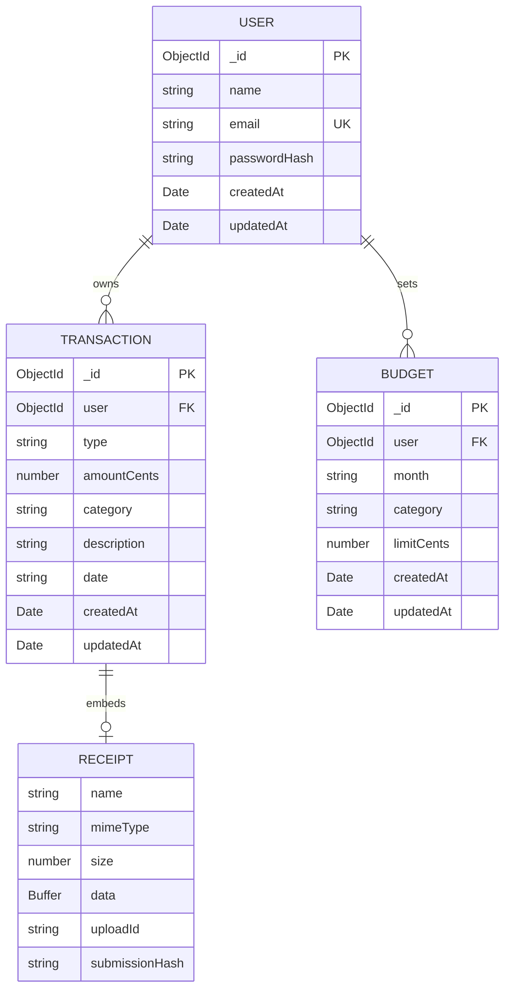

# Database design

The application uses MongoDB collections for users, transactions, budgets and sessions.
The diagram describes logical relationships. A Receipt is an embedded subdocument
inside a Transaction, **not a separate MongoDB collection**.

## Relationships

- A user can have zero or many transactions and budgets.
- Every transaction and budget stores its owner's ObjectId.
- A transaction can contain zero or one receipt. A receipt exists only inside its
  parent transaction; it has no separate `_id`.
- `FK` denotes a logical reference. MongoDB/Mongoose do not automatically enforce
  SQL-style foreign-key integrity. API authentication and owner-scoped queries
  implement access control.
- Sessions are managed separately by connect-mongo. The session includes the user
  ID; the session-ID cookie identifies the server-side session. Passwords are not
  stored in the cookie.

## Fields and validation

| Model/field | Representation and purpose |
| --- | --- |
| User.email | Trimmed/lowercased string with a unique index |
| User.passwordHash | Argon2id hash, excluded from ordinary queries |
| Transaction.type | `income` or `expense` |
| Transaction.amountCents | Safe integer from 1 to 99,999,999,999 cents |
| Transaction.category | One allowed category for the selected type; API validates the pair |
| Transaction.description | Optional trimmed text, up to 200 characters |
| Transaction.date | Real calendar date validated by the API, stored as `YYYY-MM-DD` |
| Receipt.data | Original file bytes as a Buffer, excluded from ordinary queries |
| Receipt.uploadId | Client submission reference used for retry protection |
| Receipt.submissionHash | SHA-256 fingerprint of the submission; not a password hash |
| Budget.month | `YYYY-MM` |
| Budget.category | `Overall` or an allowed expense category |
| Budget.limitCents | Positive integer-cent spending limit |

## Indexes

- User: unique `email`.
- Transaction: `(user, date descending, createdAt descending)`.
- Transaction: unique `(user, receipt.uploadId)`, applied only when uploadId is a
  string. Transactions without a receipt remain valid.
- Budget: unique `(user, month, category)`.
- Session expiry/index handling is managed by connect-mongo.

## Why the receipt is embedded

The maximum file size is 2 MB, keeping a transaction with one attachment within
MongoDB's document size limit. A transaction and its receipt can be created together
as one atomic document write. Updating editable transaction fields preserves the
receipt; deleting the transaction deletes the embedded receipt. Removing just the
receipt uses `$unset` and leaves the financial record intact.

For a larger system, files could move to private object storage with references in
MongoDB. That would require a separate upload/cleanup lifecycle and is not part of
this implementation.
